# Flow Voice — Admin quick guide

How to set up a hub and get a station talking, in about ten minutes. Screenshots are from a local dev hub
(`npm run dev`, fake Maranics); a real hub looks the same, with Maranics sign-in instead of the dev button.

Two addresses matter:

| Address | Who | What |
|---|---|---|
| `https://<hub>/admin` | Admin, on a PC | Everything in this guide |
| `https://<hub>/client` | Crew, on tablet / phone / PC | Start and run checklists by voice |

---

## 1. Sign in

Open `/admin` and sign in with your Maranics account.
Nothing is spoken or written to Flow before a user is identified, and every answer is written to Flow as the person
who is signed in on that device.

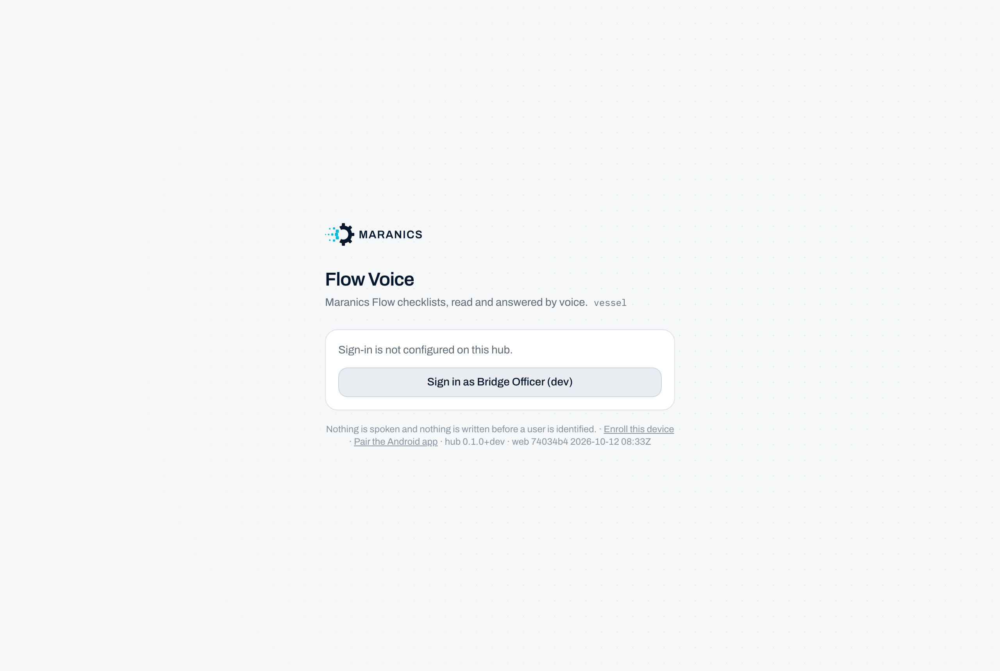

## 2. Status: the three-step setup guide

**Admin → Status** opens with *Set up in three steps*. Each step shows whether it is done and has a button that jumps
to the right tab. Below it: the client and admin links, which speech engine is in use, what is waiting to sync to
Flow, and which stations have a device connected.

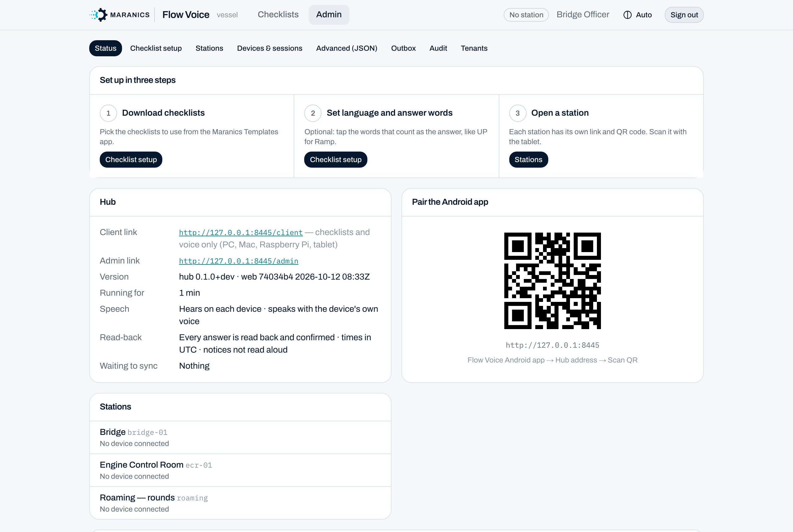

## 3. Download checklists

**Admin → Checklist setup → 1 · Download checklists** lists the templates from the Maranics Templates app.
Press **Download** on each one the crew should use. Only downloaded checklists are offered on the stations
(while nothing is downloaded, every template is offered).

Each downloaded checklist opens as a card with its settings:

- **Station language** (top right): the language the checklist is spoken and answered in. Leave on *Station language*
  to follow the station.
- **Accept a plain yes, confirm or no**: on = "yes" also answers an item; off = only the marked words count.
- **How exact must the word be heard**: *Exact* / *Normal* (a letter or so off) / *Loose*. Short words like "up" are
  always exact.
- **When to read the next item**: *At once*, *When asked (say next)*, *After a time*, or *When another system says so*.

**Download again** fetches the items after the template changed in Maranics. **Remove from hub** takes it off every station.

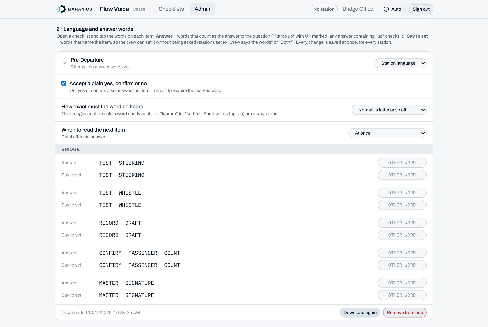

## 4. Mark answer words (optional, but worth it)

Every item has two rows of words taken from the item name. Tap a word to mark it; every tap saves at once.

- **Answer** = words that count as the answer. With **STEERING** marked on *Test steering*, "steering checked" or just
  "steering" ticks it, with no read-back question. Marked words show in the item list on the run screen.
- **Say to set** = words that *name* the item, so the crew can set it without being asked (for stations set to
  "Crew says the words" or "Both").
- **+ Other word** adds a word that is not in the item name (a local term, another language).

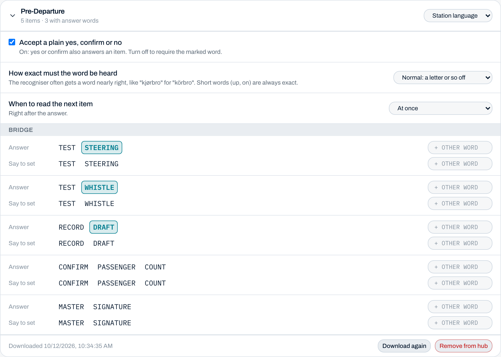

## 5. Create a station

A station is one place (Bridge, Engine Control Room, Gangway…) with its own link, QR code and six-digit code.
**Admin → Stations → Add a station**: type a name, the vessel / location, the language of the voice menu, then
**Add station**.

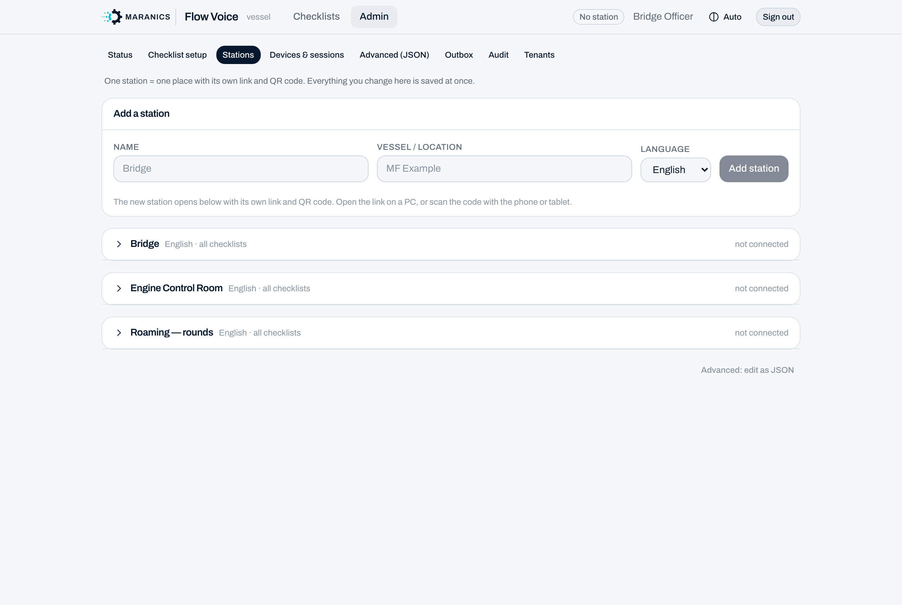

## 6. Set up the station

Click the station to open its card. Everything saves at once ("Saved ✓").

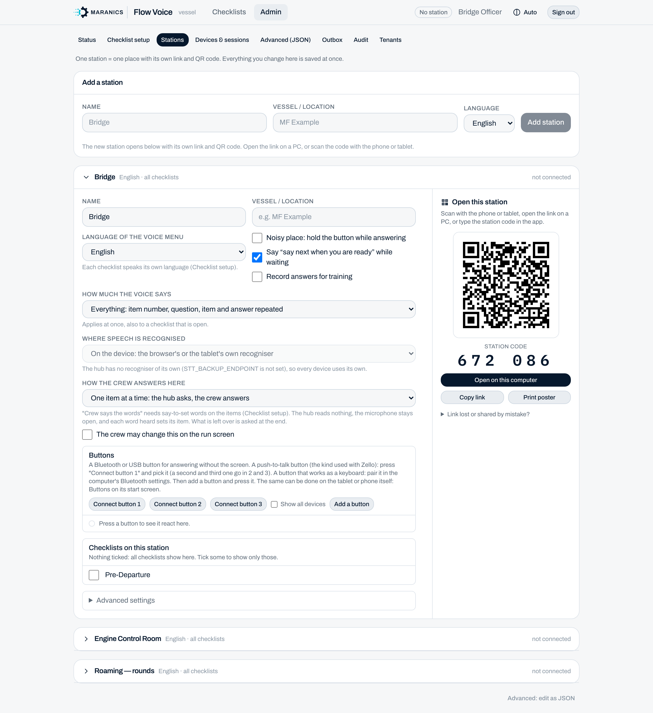

| Setting | What it does |
|---|---|
| **Noisy place: hold the button while answering** | Push-to-talk instead of an always-open microphone. |
| **Say "say next when you are ready" while waiting** | Off = the hub waits silently on checklists set to *When asked*. |
| **Record answers for training** | Off by default; also needs the central switch. The run screen tells the crew. |
| **How much the voice says** | *Everything* / *Short* / *Least*. Applies at once, also to an open checklist. |
| **Where speech is recognised** | On the device (default) or on the hub (needs a hub recogniser). |
| **How the crew answers here** | *One item at a time* (hub asks), *Crew says the words* (hub stays quiet), or *Both*. |
| **Buttons** | Bluetooth push-to-talk buttons (Connect button 1–3) or keyboard-type buttons (Add a button, press it, pick the action). Can also be set on the device itself: Home → Buttons. |
| **Checklists on this station** | Nothing ticked = all downloaded checklists. Tick to limit; per ticked one choose *can be started here* or *only continue*. |
| **Advanced settings** | Technical fields and Remove station. |

### Open the station on a device

The right column, **Open this station**, is how a device gets bound to the station:

- **Tablet / phone**: scan the QR code, or type the **station code** in the app ("Or type the station code").
- **PC / Mac / Raspberry Pi**: **Open on this computer**, or **Copy link** and open it there.
- **Print poster**: a QR poster to put up at the station.
- **Link lost or shared by mistake?** makes a new link and code; the old ones stop working at once.

A device remembers its station, also across sign-out, so the crew scans once.

## 7. What the crew sees

After opening the station link the device asks the crew member to sign in, "to continue on Bridge":

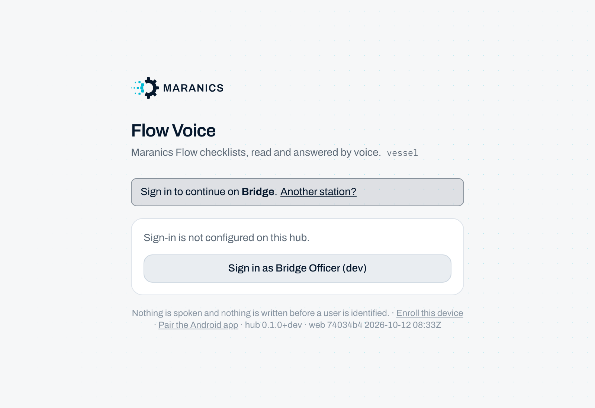

Home shows one big button per checklist: open runs first (*Continue*), then the ones that can be started here.

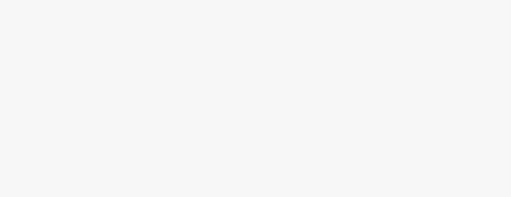

Starting a checklist starts voice hands-free. The hub reads each item, the crew answers aloud, and the list on the
right fills in: cyan = to do, green = done, amber = skipped / not synced / needs the screen. The bar at the bottom has
**Hold to talk**, **Repeat** and **Skip**. **Complete checklist** stays grey and says why until every item is answered,
and asks twice.

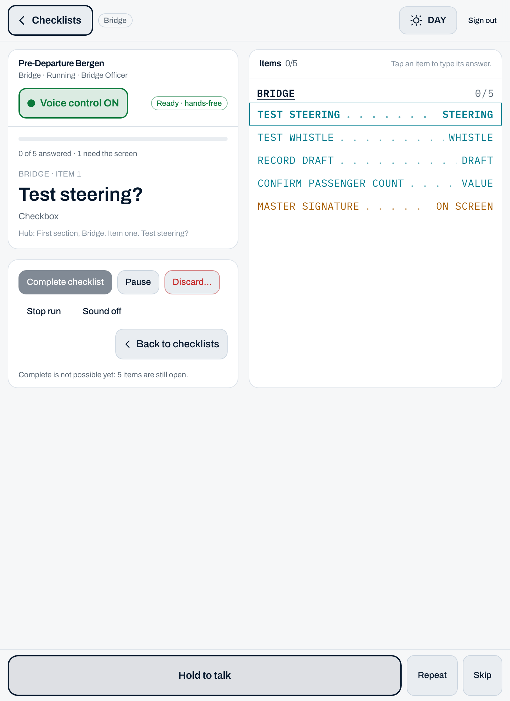

## 8. Keep an eye on it

- **Devices & sessions**: who is signed in, on which station, last seen; **Sign out** ends a session. Pending and enrolled devices sit at the top. (What each connected device is — make, model, Android version — shows on the station card.)
- **Outbox**: answers waiting to reach Flow (offline, rejected). Normally empty.
- **Audit**: every answer, button press, join and setting change, with who and when.

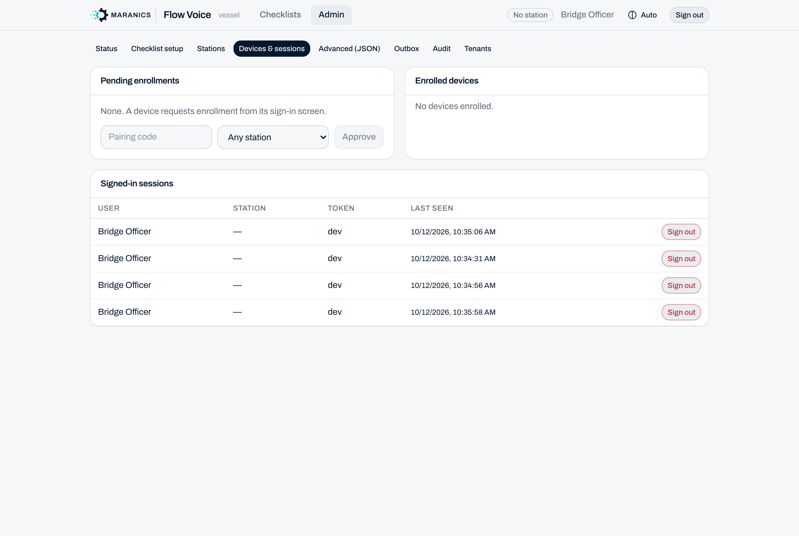

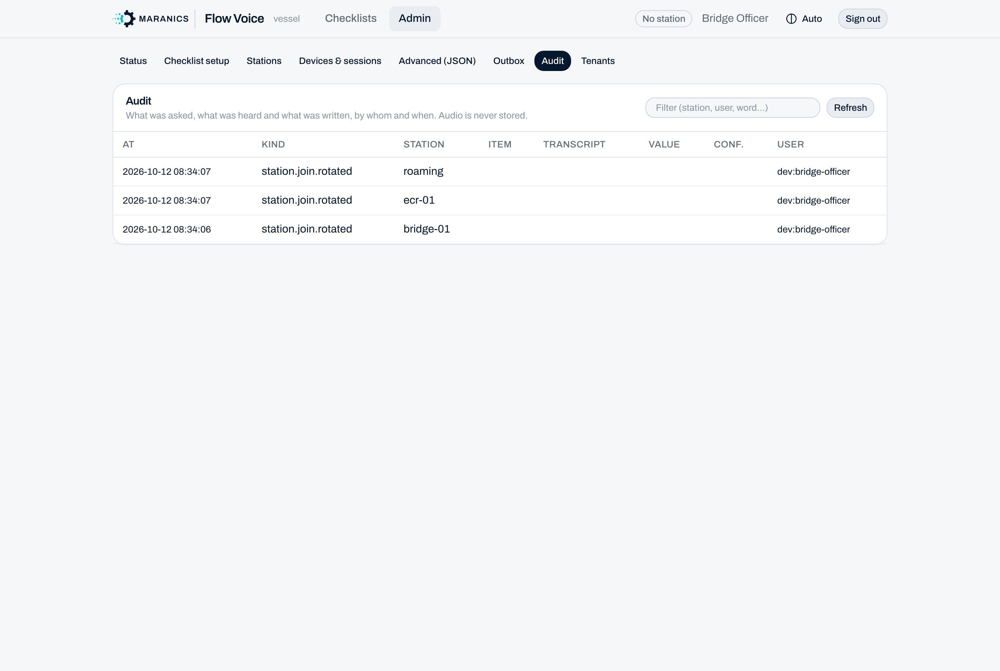

---

### Short checklist for a new vessel

1. Sign in on `/admin`.
2. Checklist setup → Download the checklists → set language → tap answer words.
3. Stations → Add a station per place → tick its checklists → pick the voice settings.
4. Print the poster (or type the station code on the tablet) → crew signs in → start a checklist.
